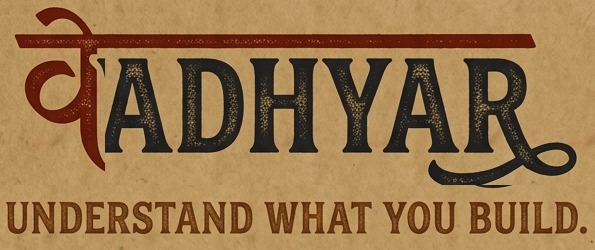
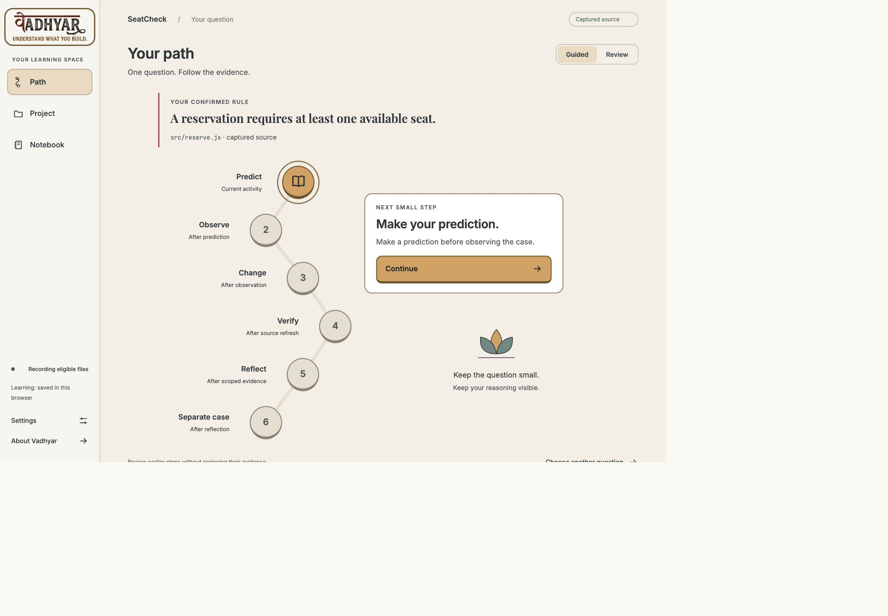
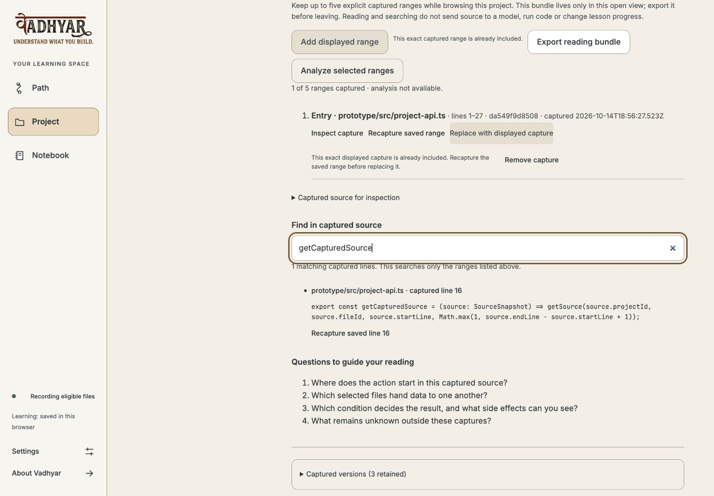

<p align="center">
  
</p>

<h1 align="center">Understand the code you build.</h1>

<p align="center">
  A local learning companion for developers building with AI.<br />
  Read real source, make a prediction, investigate a change and keep the evidence.
</p>

<p align="center">
  <a href="https://github.com/sabari-nath17/vadhyar/actions/workflows/ci.yml"></a>
  <a href="LICENSE"></a>
  
  
</p>

<p align="center">
  <a href="https://github.com/sabari-nath17/vadhyar/releases/tag/browser-v0.1.0">Download</a> ·
  <a href="docs/browser-installation.md">Installation</a> ·
  <a href="docs/getting-started.md">First question</a> ·
  <a href="CONTRIBUTING.md">Contributing</a> ·
  <a href="SECURITY.md">Security</a>
</p>

## Why Vadhyar?

AI can help you write code faster. Understanding the resulting behavior takes its own work. Vadhyar gives that work a place beside your editor: one concrete question, captured source, your reasoning and evidence you can revisit.

Keep using your existing editor or coding assistant. Vadhyar runs on your computer and follows eligible saved files in a project you approve. You make the changes; it helps you investigate them.

## A small question. A visible path.



*Actual desktop MVP capture using a sample question. Progress records activity; it is not a mastery score.*

| Workspace | What you can do |
| --- | --- |
| **Project** | Find saved source, inspect exact ranges, keep up to five captures and investigate scoped static links. |
| **Path** | Predict → Observe → Change → Verify → Reflect → Separate case, with earlier evidence preserved. |
| **Notebook** | Review questions and reflections, search records, resume and export your work. |



*Retained source search stays tied to the captured version. Reading bundles are view-local: export before leaving. [Image provenance](docs/assets/browser-image-provenance.json).*

## Install the browser companion

The **[browser preview release](https://github.com/sabari-nath17/vadhyar/releases/tag/browser-v0.1.0)** includes a prebuilt app, installer, launcher, third-party notices and checksums. Install [Node.js 24 LTS](https://nodejs.org/en/download) first; no npm install, source build or API key is required to use the packaged app.

Download the archive and checksum from the release, then:

```sh
shasum -a 256 -c vadhyar-browser-0.1.0.tar.gz.sha256
tar -xzf vadhyar-browser-0.1.0.tar.gz
cd vadhyar-browser-0.1.0
node install.mjs --to "$HOME/vadhyar-browser-0.1.0"
node "$HOME/vadhyar-browser-0.1.0/start.mjs" --project "/absolute/path/to/your/project"
```

Open the local address printed by the launcher. Keep its terminal running; **Ctrl+C** stops it. On Linux, use `sha256sum -c` for the checksum. Installation, port selection, updates, removal and troubleshooting are covered in the **[installation guide](docs/browser-installation.md)**.

This is a portable Node application. macOS installation is verified; Linux is covered by CI when its checks pass. Windows and a signed/notarized native installer remain unverified. The older **[VS Code releases](docs/installation.md)** are a separate, historical product.

## Your first investigation

1. Open a trusted local project and select one source file in **Project**.
2. Confirm one rule and one concrete case.
3. Save a prediction and the source evidence behind it.
4. Observe in your own editor or running app, then report what happened.
5. Save a change, explicitly refresh the source and compare it with your original prediction.
6. Verify with manual evidence or an existing check you explicitly approve. Reflect, try a separate case and export the record.

The [first-question guide](docs/getting-started.md) walks through these steps and explains what each record proves.

## Privacy and trust

- The host listens on **127.0.0.1** with project, Host, Origin and browser-session checks. It is a same-computer desktop companion.
- Source reading works locally. Optional OpenAI teaching requires a key, model choice and explicit excerpt approval; it is labelled assistance.
- Project checks require separate consent and run trusted repository code. They are **not sandboxed**.
- Original predictions and source identities are preserved. Self-reported observations, command outcomes and your requirement verdict remain distinct.
- Reading order and static links do not establish runtime behavior, complete coverage, authorship or learning gains.

See [security and reporting](SECURITY.md), [the behavior contract](docs/product-logic-contract.md) and [source-reading boundaries](docs/source-reading.md).

## Develop from source

Use Node.js 24 LTS or the supported Node.js 26 runtime and the pinned npm 11.19.0. This route needs the development dependencies; the packaged installer above does not.

```sh
git clone https://github.com/sabari-nath17/vadhyar.git
cd vadhyar
npm ci --ignore-scripts
npm run prototype:start -- --project "/absolute/path/to/your/project"
```

For a separate instance, choose an unused `VADHYAR_MOCK_PORT`; do not stop another learner's session. [Developer setup and commands](CONTRIBUTING.md) covers root checks, browser checks, packaging and the optional coach evaluator.

## Project status

The local desktop MVP has executed source, learning, recovery and browser acceptance receipts. The new distribution adds a fresh-install gate and independent review. This is an early preview, with limits stated in the [release verification](docs/browser-release-verification.md).

The full development dependency audit retains a temporary, narrowly scoped exception for an unpatched optional evaluation dependency. The shipped browser bundle excludes that tool; native reports and expiry are preserved. **[Read the dependency risk decision](docs/dependency-risk.md).** A clean production audit is not a claim that the full development audit is clean.

Live teacher quality, real learner outcomes, comprehensive accessibility/device coverage, phone/LAN access, cloud sync and shared editor adapters are not established by this release.

## Documentation

| Read | Purpose |
| --- | --- |
| [Install, update and remove](docs/browser-installation.md) | Packaged app setup and troubleshooting |
| [First question](docs/getting-started.md) | A complete investigation beside your existing editor |
| [Feature contract](prototype/feature-contract.md) | Implemented behavior and limits |
| [Contributing](CONTRIBUTING.md) | Development and review workflow |
| [Security](SECURITY.md) | Trust boundaries and private vulnerability reporting |
| [Release verification](docs/browser-release-verification.md) | Actual checks, package identities and remaining gaps |
| [Changelog](CHANGELOG.md) | Detailed project history |
| [AI usage](AI_USAGE.md) | Recorded Codex assistance and human-review boundaries |

## Origins and license

Vadhyar began at the DevDay Exchange Community Hackathon in Kochi, 10–11 October 2026. Product development continued afterward. The [event rules](RULES.md), [submission record](SUBMISSION.md), [earlier GitHub overview](docs/archive/github-readme-before-browser-release.md) and [local milestone overview](docs/archive/local-readme-before-browser-release.md) preserve that history.

Current project source is licensed under **[MIT](LICENSE)**. Retained libraries, adapted source, fonts and assets keep their own notices in [THIRD_PARTY_NOTICES.md](THIRD_PARTY_NOTICES.md) and the packaged notices. Earlier releases retain their original metadata and scope.
