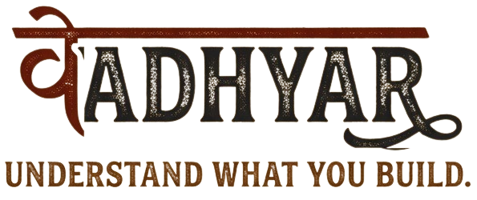

<p align="center">
  
</p>

<h1 align="center">Understand the code you build.</h1>

<p align="center">
  A local learning companion for developers building with AI.<br />
  Read real source, make a prediction, investigate a change and keep the evidence.
</p>

<p align="center">
  <a href="https://github.com/sabari-nath17/vadhyar/actions/workflows/ci.yml"></a>
  <a href="LICENSE"></a>
  
  
</p>

<p align="center">
  <a href="https://github.com/sabari-nath17/vadhyar/releases/tag/browser-v0.1.0">Download</a> ·
  <a href="docs/browser-installation.md">Installation</a> ·
  <a href="docs/getting-started.md">First question</a> ·
  <a href="CONTRIBUTING.md">Contributing</a> ·
  <a href="SECURITY.md">Security</a>
</p>

## Why Vadhyar?

AI can help you write code faster. Understanding the resulting behavior takes its own work. Vadhyar gives that work a place beside your editor: one concrete question, captured source, your reasoning and evidence you can revisit.

Keep using your existing editor or coding assistant. Vadhyar runs on your computer and follows eligible saved files in a project you approve. You make the changes; it helps you investigate them.

## A small question. A visible path.


*Desktop MVP capture using sample learning records before release packaging. Progress records activity; it is not a mastery score.*

| Workspace | What you can do |
| --- | --- |
| **Project** | Find saved source, inspect exact ranges, keep up to five captures and investigate scoped static links. |
| **Path** | Predict → Observe → Change → Verify → Reflect → Separate case, with earlier evidence preserved. |
| **Notebook** | Review questions and reflections, search records and export your work. |


*Retained source search stays tied to the captured version. Reading bundles are view-local: export before leaving. [Image provenance](docs/assets/browser-image-provenance.json).*

## Install the browser companion

The **[browser 0.1.0 preview](https://github.com/sabari-nath17/vadhyar/releases/tag/browser-v0.1.0)** includes a prebuilt app, installer, launcher, third-party notices and checksums. Install [Node.js 24 LTS](https://nodejs.org/en/download) first; no npm install, source build or API key is required to use the packaged app.

Download the archive and checksum from the release, then:

```sh
shasum -a 256 -c vadhyar-browser-0.1.0.tar.gz.sha256
tar -xzf vadhyar-browser-0.1.0.tar.gz
cd vadhyar-browser-0.1.0
node install.mjs --to "$HOME/vadhyar-browser-0.1.0"
node "$HOME/vadhyar-browser-0.1.0/start.mjs" --project "/absolute/path/to/your/project"
```

Open the local address printed by the launcher. Keep its terminal running; **Ctrl+C** stops it. On Linux, use `sha256sum -c` for the checksum. See the **[installation guide](docs/browser-installation.md)** for ports, updates, removal and troubleshooting.

macOS fresh installation and the release's Linux/macOS CI are [recorded](docs/browser-release-verification.md). Windows and signed/notarized native installation remain unverified. The published archive stays tied to its original source and predates the latest consent, source-validation and focus corrections. Use the source setup below for the current revision; this cleanup does not replace that download.

## Your first investigation

1. Open a trusted local project and select one source file in **Project**.
2. Confirm one rule and one concrete case.
3. Save a prediction and the source evidence behind it.
4. Observe in your editor or running app, then report what happened.
5. Save a change in your editor if needed, or explain why the existing source already meets the rule. Explicitly refresh the source and compare it with the original prediction.
6. Verify with manual evidence or an existing check you explicitly approve. Reflect, try a separate case and export the record.

The [first-question guide](docs/getting-started.md) explains the workflow and what each record proves.

## Privacy and trust

- The host listens on **127.0.0.1** with project, Host, Origin and browser-session checks. It is a same-computer desktop companion.
- Source reading works locally. Optional OpenAI teaching requires a key, model choice and approval of the source excerpt, rule and case; it is labelled assistance.
- Project checks require separate consent and run trusted repository code without a sandbox.
- Original predictions and source identities are preserved. Self-reported observations, command outcomes and your requirement verdict remain distinct.
- Reading order and static links do not establish runtime behavior, complete coverage, authorship or learning gains.

See [security](SECURITY.md), [the behavior contract](docs/product-logic-contract.md) and [source-reading boundaries](docs/source-reading.md).

## Develop from source

Use Node.js 24 LTS or Node.js 26 and the pinned npm 11.19.0:

```sh
git clone https://github.com/sabari-nath17/vadhyar.git
cd vadhyar
npm install --global npm@11.19.0 --ignore-scripts
npm ci --ignore-scripts
npm start -- --project "/absolute/path/to/your/project"
```

Choose an unused `VADHYAR_MOCK_PORT` for another instance; preserve existing learner sessions. [Contributing](CONTRIBUTING.md) covers browser checks and portable packaging. The current source tree contains the browser product; earlier native/demo/research material remains in [immutable project history](docs/history.md).

## Status and documentation

This is an early desktop preview. [Release verification](docs/browser-release-verification.md) preserves exact source, archive and installed-browser evidence. Current source uses a [strict full and production dependency gate](docs/dependency-risk.md); the published preview's earlier dependency decision is historical and remains disclosed with that artifact.

Live teacher quality, real learner outcomes, comprehensive accessibility/device coverage, phone/LAN access, cloud sync and shared editor adapters remain unverified or unavailable.

| Read | Purpose |
| --- | --- |
| [Install, update and remove](docs/browser-installation.md) | Packaged app setup |
| [First question](docs/getting-started.md) | Investigation beside your editor |
| [Feature contract](prototype/feature-contract.md) | Current behavior and limits |
| [Browser design](prototype/DESIGN.md) | Current interface principles |
| [Source reuse](docs/browser-reuse.md) | Donor mappings and modifications |
| [Changelog](CHANGELOG.md) | Current milestone record and historical ledger |
| [AI usage](AI_USAGE.md) | Assistance and human-review boundaries |
| [History](docs/history.md) | Earlier native releases, research and evidence |

## Origins and license

Vadhyar began at the DevDay Exchange Community Hackathon in Kochi, 10–11 October 2026, and continued afterward. Original event rules, submission and native product artifacts remain in [project history](docs/history.md).

Current source is licensed under **[MIT](LICENSE)**. Libraries, adapted source, fonts and assets retain their own [third-party notices](THIRD_PARTY_NOTICES.md). Earlier releases preserve their original metadata, notices and scope.

## Next milestone planning

The [connected-lesson specification](docs/product-logic-contract.md), [implementation plan](docs/implementation-plan.md) and [capability register](docs/capability-register.md) record the next milestone. Further tutoring, practice and specialist journeys are deferred at the current stability checkpoint and are not current availability claims.
