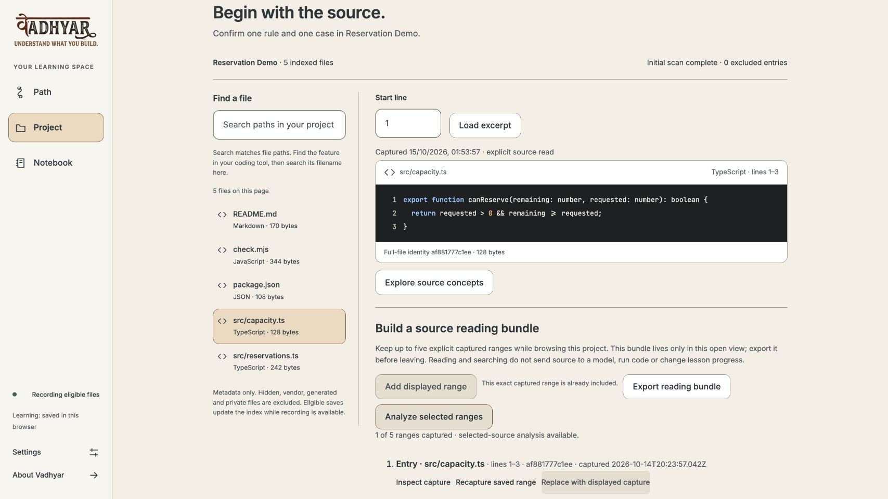

# Browser preview verification

**Release scope: a portable local desktop preview, with explicit limits.** The source and package receive separate checks. The published archive's checksum and `BUILD_INFO.json` identify its exact inputs; the release is not a signed native app.

This page preserves the **published `browser-v0.1.0` artifact and its earlier source gates**. Browser-only cleanup does not rebuild or replace that download. Current source uses [strict dependency audits](dependency-risk.md); its checks and dependency tree are separate from the historical counts below.

## Checked behavior

- The desktop MVP's real Vadhyar-source investigation retained five exact ranges across four files, with source identities, cited entry/data/guard/storage explanations, captured search and export. Its [acceptance receipt](https://github.com/sabari-nath17/vadhyar/blob/92e118d542ab7332a6d6821929a870cc25187516/docs/logic-evidence/persona-real-reader-acceptance.json) and [later corrections](https://github.com/sabari-nath17/vadhyar/blob/92e118d542ab7332a6d6821929a870cc25187516/docs/quality/2026-10-15-ponytail-check.md) retain their separate source/checkpoint scopes.
- The later quality slice passed 137 root, 128 browser-unit and 75 local-service cases, both typechecks/lints and isolated builds. It corrected source-list pagination, reset invalidation, concurrent recorder flushes and experimental native-guide selection. Actual paging/failure/retry/late-response browser probes are recorded in its receipt; no learner efficacy is inferred.
- The legacy command-output privacy correction first reproduced two failures, then retained credential recognition before bounded output truncation while preserving execution facts. Focused process/domain tests passed. The earlier red-team evidence remains historical, with corrections described in the [original changelog](https://github.com/sabari-nath17/vadhyar/blob/92e118d542ab7332a6d6821929a870cc25187516/CHANGELOG.md).
- The installer development gate passed three Node.js 24.19.0 cases: altered-file refusal, fresh CLI installation into a spaced path, protected installed-host source/knowledge/assets and one explicitly consented synthetic check. It performed no provider call or automatic npm hook. Final packaging is built from committed source and independently rechecked before upload.
- An independent artifact review verified the allowlisted manifest/hashes, complete MIT/vendor notices, no undeclared AppleDouble metadata and normalized archive ownership. The packager builds in isolation; its regression protects the existing served browser bundle.
- CI syntax, official action pins, YAML/forms and a deliberate invalid-matrix control were checked. Hosted job results remain visible in [GitHub Actions](https://github.com/sabari-nath17/vadhyar/actions/workflows/ci.yml); a local workflow check is not a claim that a hosted run passed.

## Prerelease source checkpoint

At 2026-10-15T01:38:02+05:30, clean merged source `1e067cb5daf188b798f8b825f82529b479927551` passed fresh Node 24.19.0 / npm 11.19.0 installation (737 packages), root typecheck/lint/build and **141 root, 128 browser, 75 service, 3 installer and 3 risk-policy cases**, plus six offline evaluator fixtures with zero provider requests. Builds and fixtures ran in a disposable clone; both primary hosted asset hashes remained unchanged. The [machine-readable receipt](browser-release-evidence.json) distinguishes the native full audit's three high development findings from zero production findings. Later archive/publication identities remain separately recorded.

## Dependency decision

At this release checkpoint, the targeted FTP dependency correction changed only `basic-ftp` from 5.3.1 to 6.2.3. The native production audit had no findings; the full development audit retained three high findings in an optional Promptfoo certificate-import chain with no published node-forge patch.

The [temporary risk policy](https://github.com/sabari-nath17/vadhyar/blob/92e118d542ab7332a6d6821929a870cc25187516/docs/security/dependency-exceptions.json) and [original decision](https://github.com/sabari-nath17/vadhyar/blob/92e118d542ab7332a6d6821929a870cc25187516/docs/dependency-risk.md) preserve that distinction. Three risk-policy tests cover changed scope/version/chain, missing or changed advisory, inconsistent reports and expiry. An isolated mutation removing expiry refusal was detected. Native full audit exit 1 and production exit 0 remain in the triage receipt. The actual packaged runtime/client input lists exclude the affected tool; no full-clean-audit claim is made.

## Preservation and corrections

The first packaging development attempts rebuilt ignored assets served by the user's existing local host. No page reload, host operation or learning-record change occurred. Packaging now builds both client and host from isolated copies. The original served JS/CSS hashes were restored from an independently matched prior QA build; other assets already matched. A regenerated candidate that did not match was refused. Subsequent installer checks assert noninterference.

Mac tar initially added undeclared `._` metadata; the environment and ownership normalization were corrected, and the exact-member regression and independent re-review passed. Earlier failed test assumptions and source/artifact snapshots are not relabelled as successful final release runs.

The first committed browser archive passed its manifest/HTTP and hosted source gates but failed actual client startup with `React is not defined`. It was **rejected before release publication**. The isolated build had omitted the root/prototype compiler configurations, changing JSX output. The minimal correction copies both configurations and records their hashes; an actual packaged-entry regression reproduced the error, then passed along with all four installer cases and root typecheck/lint. This targeted regression complements the required rendered acceptance of the replacement archive. The rejected archive identity remains in the receipt.

## Remaining limits

- Node.js 24 LTS is required separately. No bundled Node runtime, notarization or native OS installation service is supplied.
- macOS fresh installation is verified. Linux/macOS release CI passed as recorded below; Windows install/process execution remains unverified.
- Learning records remain browser/profile/origin-local. Reading bundles are view-local and require export before leaving. Install updates into a new directory and preserve other active sessions.
- Project commands execute trusted repository code without a sandbox. Optional live teaching quality, full compound-fault/accessibility/device coverage and real learner outcomes remain unverified.
- Human review is pending. Codex implementation and independent AI reviews are recorded in [AI_USAGE.md](../AI_USAGE.md); simulated personas are not human participants.

## Recovery

Stop only the new instance with Ctrl+C and return to a prior installation directory/port if needed. Export before clearing browser records; removing an installation does not erase recorder or browser storage. Prior VSIX releases and source history remain available. Never force-push or replace an existing release artifact silently.

## Published preview — 2026-10-15T02:02:10+05:30

**[Browser 0.1.0](https://github.com/sabari-nath17/vadhyar/releases/tag/browser-v0.1.0) is published as a prerelease** from immutable source `2465b5d04505c88babc6ed1f018070844b5d5dce`. Archive SHA-256: `d5cdf484c3aa0cc9bdbc6f5efd17b628730122794b15c951301d32d73b7dd78d` (4,287,839 bytes). GitHub asset digests and both completed downloads match the locally reviewed bytes; a second fresh CLI installation from those downloads verifies all 23 installed manifest files.

The replacement passed four installer cases, independent review of 24 regular members/453 source/config/input identities and the exact MIT/vendor/donor/font notices. The actual installed browser rendered Path, Project and Notebook; selected `src/capacity.ts`, captured/analyzed its complete declaration and exported one exact range, with zero new browser warnings/errors. The synthetic fixture's one approved command is separate from that source reading; no model call or learner-efficacy claim. The [installed-runtime receipt](browser-release-evidence/installed-runtime.json), [independent artifact receipt](browser-release-evidence/independent-artifact.json), [exact reading export](browser-release-evidence/reading-bundle.json) and [downloaded-install receipt](browser-release-evidence/downloaded-install.json) retain their scopes.

[Hosted source CI](https://github.com/sabari-nath17/vadhyar/actions/runs/38631043086) passed Linux/Node24, macOS/Node24, macOS/Node26, dependency risk triage and portable packaging. PR-only dependency review was skipped on this push; it is configured and required for future pull requests, not claimed exercised here. Main protection requires these checks from GitHub Actions, including administrators, with force pushes/deletion disabled; [actual settings](browser-release-evidence/github-settings.json). MIT detection, description/topics, current download homepage, private reports, dependency alerts/security updates and existing secret scanning/push protection were verified. Every local branch commit is reachable on GitHub; local runtime copies/raw media remain deliberately ignored. Legacy native tags/assets match their recorded immutable identities/digests.

The publication documentation checkpoint records these completed events; the release tag stays bound to its original tested build source. Human review, Windows/native signing and this artifact’s original development dependency decision remain separately scoped. Current source cleanup removes the optional evaluator and its exception; it does not relabel the release’s native audit exit 1 as clean.
