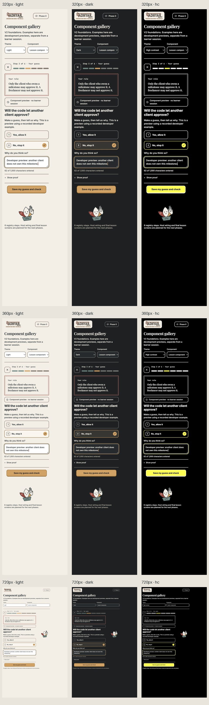

# Phase 0 — foundations and component gallery

## Scope

Branch: `codex/design-v2-phase-0`, base `21fdcc9`. Work is isolated from the current primary checkout. Read its DESIGN.md, the supplied design-v2.md and PRODUCT.md before implementation; v2 takes precedence. The original extension entrypoint, host, shared schema, runner, fixture and stored sessions are untouched.

Implemented: local variable fonts, light/dark/native high-contrast tokens, the §5 component library, six plain-language step labels, and a developer-only `/gallery/`. Generated all 26 §10 SVGs before gallery screens. The guide is vector geometry, not a remote image. Original wordmark pixels are unchanged.

`npm run gallery -- --port 4187` starts the local preview; `npm run build:gallery` creates its static output. `npm run record:gallery` reruns the disclosed developer scenario in disposable copies, without changing the seed, and replaces [recorded-checks.json](recorded-checks.json). Rebuild the gallery after rerecording. These are developer records, not learner evidence or live API responses.

## Screenshots

All nine views use actual CSS viewport measurements: 320, 360 and 720 × 640. The in-app browser is at 75% zoom, so physical overrides are scaled to produce the required CSS widths. Fonts loaded in all views. No horizontal overflow.

| Width | Light | Dark | High contrast |
|---|---|---|---|
| 320 | [View](screenshots/gallery-320-light.jpg) | [View](screenshots/gallery-320-dark.jpg) | [View](screenshots/gallery-320-hc.jpg) |
| 360 | [View](screenshots/gallery-360-light.jpg) | [View](screenshots/gallery-360-dark.jpg) | [View](screenshots/gallery-360-hc.jpg) |
| 720 | [View](screenshots/gallery-720-light.jpg) | [View](screenshots/gallery-720-dark.jpg) | [View](screenshots/gallery-720-hc.jpg) |

## Executed checks

- Typecheck and lint passed. Focused evidence/asset/token tests: 9/9. Full milestone suite: 45/45 across 11 files; [full log](verification-tests.txt). Original extension and gallery builds passed.
- [Component matrix](component-matrix.json): 8 views × 9 size/theme combinations. No overflow, broken images, duplicate dominant actions or actionable planned nodes.
- [Gate matrix](gate-matrix.json): 9 gallery gate specimens × 3 themes at 360px. These show presentation/recovery copy, not fault-injected host behavior.
- [Browser checks](browser-checks.json): keyboard answers 1 then 2, typing without shortcut interception, disabled reason, and sheet focus return.
- [Selected answer contrast](selected-answer-contrast.json): initial dark selected text failed at 1.06:1; scoped mix fixed it to 10.56:1. Light is 11.62:1, high-contrast fallback 21:1.
- [Asset review](asset-review.json): 26 inert SVGs inspected at 32px and 360px. No scripts, links, baked text or runtime URLs.

Regressions were observed before correction for keyboard selection, Esc focus, 320px select overflow, the missing hand in brand geometry and the dark selected-card contrast. Mechanical Impeccable findings for Inter, the revised type scale and segment radius are documented v2 brief overrides, not automatically accepted as defects.

## Deviations and honest limits

See [spec rulings](../../../design-v2.md#19-implementation-rulings-and-simple-language). Accessibility token adjustments, plain step labels, inert planned nodes, assets-before-screens, withheld authorship stickers and non-sequenced runner rows are intentional. Main checkout has newer capabilities; Phase 2 must preserve them.

Superpowers review was performed in-thread because side conversations prohibit agents. Human acceptance, native VS Code theme mapping, OS reduced-motion behavior, final lesson screens, sound and demo reset are not verified by this gallery. No API call, credential access, push, merge or Marketplace publication occurred.
