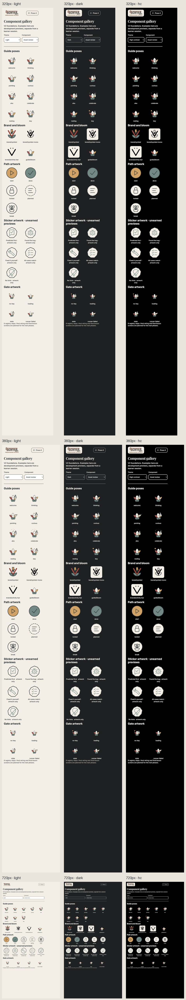

# Phase 1 — generated asset review

All 26 §10 SVGs were generated before Phase 0 screens as the user requested. This phase reviews them at 320, 360 and 720 CSS px in light, dark and high-contrast fallback themes. All 27 images (26 assets plus original wordmark) loaded in every view; no horizontal overflow. [Measured matrix](matrix.json).

| Width | Light | Dark | High contrast |
|---|---|---|---|
| 320 | [View](screenshots/assets-320-light.jpg) | [View](screenshots/assets-320-dark.jpg) | [View](screenshots/assets-320-hc.jpg) |
| 360 | [View](screenshots/assets-360-light.jpg) | [View](screenshots/assets-360-dark.jpg) | [View](screenshots/assets-360-hc.jpg) |
| 720 | [View](screenshots/assets-720-light.jpg) | [View](screenshots/assets-720-dark.jpg) | [View](screenshots/assets-720-hc.jpg) |

The separate [32px/360px reviews](../phase-0/asset-review.json) and [foundation tests](../../../tests/v2-foundations.test.ts) establish file presence, inert SVG contents, motion group IDs and corrected hand geometry. Artwork specimens are explicitly **unearned**. Original logo and font license bytes are preserved.

No new host action, API request, asset download or dependency. Native VS Code theme mapping and screen-reader acceptance are later integration checks.
