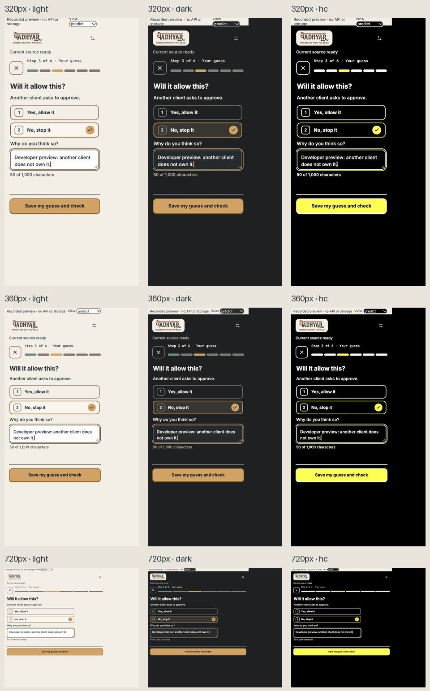

# Phase 2 — real renderer and existing actions

The six lesson IDs and host availability rules are unchanged. The registry now supplies plain names; task content scrolls above a visible ActionBar. Consent, source links, mapping approval, prediction saving, counters, hints, diff, reruns, transfer, reflection, import, walkthrough, exports, session controls and Project Guide remain connected to their original actions.

[Action coverage](action-coverage.json): all 41 baseline literal action types retained. [Browser action records](actions.json) preserve exact source/sharing identities and prediction content, and pass the existing strict message schema. No counterexample is requested until save acknowledgement.

## Screenshots

| Width | Light | Dark | High contrast |
|---|---|---|---|
| 320 | [View](screenshots/lesson-320-light.jpg) | [View](screenshots/lesson-320-dark.jpg) | [View](screenshots/lesson-320-hc.jpg) |
| 360 | [View](screenshots/lesson-360-light.jpg) | [View](screenshots/lesson-360-dark.jpg) | [View](screenshots/lesson-360-hc.jpg) |
| 720 | [View](screenshots/lesson-720-light.jpg) | [View](screenshots/lesson-720-dark.jpg) | [View](screenshots/lesson-720-hc.jpg) |

The real panel bundle is rendered using a **recorded developer preview**, not a live learner/API session. The footer remains visible at all widths. After a measured initial failure (reason field bottom 717px, action top 537px), the prediction screen omits art, uses shorter copy and fits both choices plus the reason field above the action at 320/360/720. Other task screens retain the Guide.

[State matrix](state-matrix.json): 12 lesson/gate specimens × 3 themes at 360×640; all primary controls visible, no horizontal overflow or broken images. These verify presentation, not native fault injection.

## Executed checks and boundaries

Typecheck/lint/build pass. Full suite **123/123 across 26 files**; [output](tests.txt). The suite includes immutable hash comparison against current app baseline `29db3ef`; host/shared/project/fixture files remain byte-identical. SVGs are copied into the existing local resource root and included in packaging. No new dependency, external request or runtime font fetch.

The test runner initially omitted TSX test files; its include pattern was corrected and all eight UI boundary tests actually executed. A preview script lint error was corrected before the final pass.

Native launch was attempted in a disposable profile. Computer Use surfaced an existing S13 window rather than an identifiable isolated review window; no source, settings or data in that window were changed. Native integration/theme acceptance remains unverified here.

Reproduce the labelled browser preview with `npm run build`, `node scripts/panel-preview.mjs`, then `npm run gallery -- --port 4187` and open `/gallery/preview/index.html`. The preview records messages and never executes host actions, storage or API calls. It is excluded from the VSIX.
