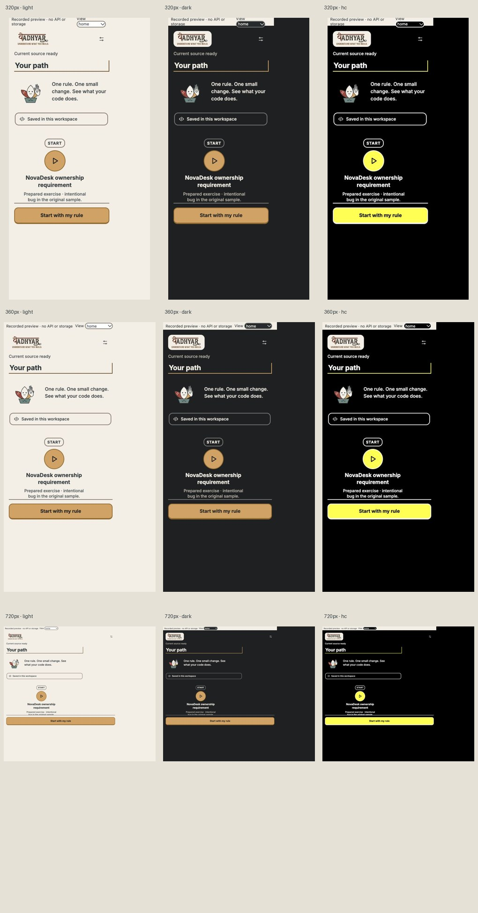

# Phase 3 — path and proof

Real host records supply the rule title, resume stage, completion, case counts, hint counts and evidence rows. The prepared exercise stays disclosed; imported rules stay explanation-only. Existing transfer is unlocked only after current trusted checks pass. Project Guide remains available through its existing editor command, with a separate four-task presentation and all original actions.

## Screenshots

[Start](screenshots/start-matrix.jpg) · [Completion](screenshots/completion-matrix.jpg) · [Proof](screenshots/evidence-matrix.jpg). Each has 320/360/720 CSS px × light/dark/high contrast. These are labelled developer previews, not new live API/native acceptance.

## Checks

Full 127/127 across 26 files; typecheck/lint/build pass. Existing host/controller/contract/fixture hashes unchanged; live UI action coverage preserves the baseline types. New regressions failed for missing trusted-current gating and transfer completeness, then passed. Counts require the actual complete case set; unknown hints are not zero. Independent-authorship and source-open achievements remain withheld.

[Path/start metrics](path-and-start.json), [completion/proof metrics](completion-and-evidence.json), [draft and focus preservation](navigation.json), [test output](tests.txt). All captured actions remain in the existing contract. Native end-to-end acceptance is still pending because the isolated editor window could not be identified without touching the primary session.

The developer gallery interprets its saved check record at that record’s code version; it does not claim current workspace verification. Historical evidence JSON remains unchanged.
