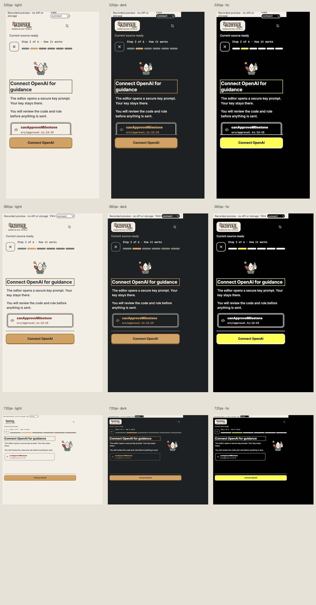

# Phase 4 — states, motion and sound

The existing actions handle missing keys, reviewed sharing, extraction/loading, API errors, unsaved/stale context, unavailable prerequisites, observed failures and runner errors. Confirm now expands the actual requirement examples. Unknown imported/hint counts stay unknown. Typed prediction/idea drafts survive errors; a submitted idea waits for a matching host acknowledgement.

[State matrix](state-matrix.json): 18 additional loading/extraction/error/unsaved/runner/gated views across the three themes, with one visible primary and no overflow. Busy states were entered after opening a ready lesson; the first attempt to open an already-busy lesson was correctly blocked. Presentation specimens are explicitly labelled; this is not native fault injection.

[Controls](controls.json) records off-by-default sound, Escape/focus return and the existing strict cancelExplain action. [SVG motion](motion.json) records real external SVG part bounds, 900ms/one-iteration petal motion; the path ring runs three cycles. A completion animates once per recorded run while this panel is open. Sound uses bounded local WebAudio tones, no fetch/storage; unavailable audio leaves the lesson working. No sound was enabled in browser acceptance.

Full **131/131 across 27 files**, typecheck/lint/build and focused 20/20 pass; [output](tests.txt). A React ref typing error was corrected before final validation. Immutable host/contract/controller/fixture hashes and baseline action coverage pass. No dependency, API request or runtime font fetch introduced.

Reduced-motion CSS removes every animation/transition and pressed transform. The available browser controls offer no media emulation; native OS preference, audible hardware and native integrated workflow remain unverified.
