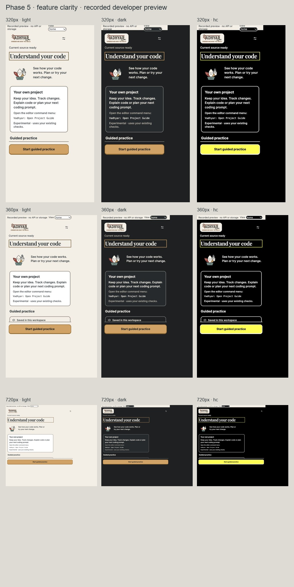
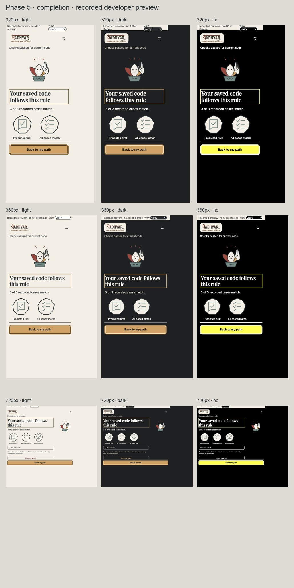
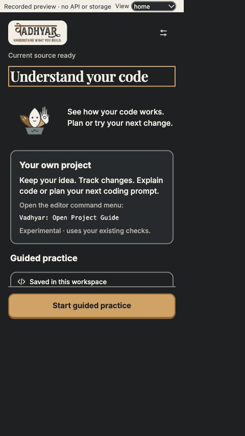

# Phase 5 — final presentation review

The keyboard primary shortcut respects text fields, native controls, modifiers and the game. Prediction/reflection submission uses the same readiness gates as its button. Snake opens immediately from its optional path node; theme aliases resolve on the theme-owning body. Completion uses one generated character and the SVG's own slate ink, keeping face detail visible in dark/high contrast. Settings clearly labels demo reset and recorded-answer fallback **planned**.

## Screenshots

Actual CSS widths 320, 360 and 720 × 640, each in light, dark and high-contrast fallback. The browser's 75% zoom requires scaled physical overrides; [measured completion views](screenshots.json) verify width, no horizontal overflow, visible primary, all images loaded and real SVG parts. The path shots use the same measurements.

These are labelled developer previews. Counters, case rows and earned stickers use [the preserved executed developer record](../phase-0/recorded-checks.json); they are not new learner evidence or live API/runner results.

## Executed checks

- Typecheck, lint, original extension build and gallery build passed. Initial Phase 5 **135/135 across 27 files**; [actual output](tests.txt). The communication follow-up passed **136/136 across 27 files**; [latest output](orientation-tests.txt). Immutable host/shared/project/fixture hashes and baseline UI action coverage pass. No dependencies changed.
- [Keyboard messages](keyboard.json): Enter opens the start sheet and lesson; `2` chooses No; Enter cannot save without a reason; Enter in the reason field preserves a newline. The saved message retains exact identities/text and conforms to the original schema. No counterexample runs before host acknowledgement. This is a preview message-boundary check, not a complete native keyboard rehearsal.
- [Snake](snake.json): expanded local board, theme-correct dark/HC color aliases, no width overflow, board Enter stays in the game and Escape actually pauses. Game counters come from its engine and never become learning progress.
- The final contact sheet exposed white theme strokes obscuring the light character face. A failing ink regression was added, the inherited stroke was replaced with the generated SVG's original slate, and focused/full checks passed. Completion was recaptured in all nine combinations.
- Local fonts/art and reduced-motion overrides are checked. No browser media emulation or audio was enabled; native OS preferences, audible output, screen readers and real editor integration remain unverified.

## Capture walkthrough

Ten actual browser captures over 35 seconds: path, start, rule, reviewed sharing, prediction, recorded observation, change task, recorded verification, completion and proof. [Capture scope](walkthrough.json) documents the developer scene selection. This is a GIF walkthrough assembled from screenshots, **not continuous native video**. It performs no source edit, API, storage or runner operation.

## Feature communication follow-up

The user asked whether the UI explains the product and exposes its features. The updated home now puts **Your own project** before **Guided practice**, names idea tracking, code explanation and next coding prompts, and explicitly labels the practice action. The Project Guide introduction explains its purpose before the first snapshot action. No new capability, action or host behavior was added. [Feature map and limits](features.md).

[Nine measured home views](orientation.json) show both entry labels and the primary without horizontal overflow at all requested widths/themes. The matrix above and the walkthrough's first frame were updated. [Three Project Guide introductions](project-intro.json) preserve one visible primary and no overflow. These are labelled unstarted presentation specimens; native capture/API/state acknowledgement remains unverified. The orientation regression failed before the copy/layout change, then the focused/full checks passed.

## Package and remaining acceptance

The local review VSIX is built with the existing package tooling for `darwin-arm64`. Static inspection verified 26 SVGs, four runtime fonts and three font license notices; runtime resource bytes match the built files. Dependencies, prerequisites, commands, trust capabilities and all 23 immutable source files match baseline 29db3ef. The prepared ownership/transfer harness and fresh-demo command are bundled; developer gallery and preview are not runtime routes. No secret session, environment, Git or Graphify virtual-environment files are included.

The existing production dependency tree produces a large file-count advisory (about 9,300 entries, about 40 MB compressed); this UI revision does not prune the trusted runtime. Verification metadata sits beside the installer in `dist/vadhyar-v2-review-darwin-arm64.checks.json`, outside the source and installer to avoid a self-referential archive hash. This is not a Marketplace/publication or native install acceptance claim.

[Review, backup, reproduction and native follow-up](../README.md). [Same-change spec deviations](../../../design-v2.md#phase-5-rulings-and-deviations): planned host-dependent demo mode and screenshot-GIF substitution. Human ease-of-use and redesigned native-host acceptance remain pending; no child-usability or learning-gain claim is made.
