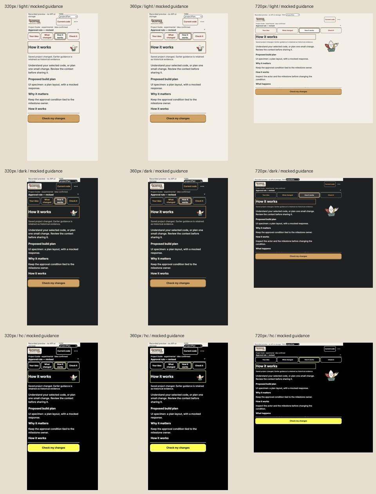

# Project Guide routes

The idea, changes, guidance and check steps share a pinned shell. Saved ideas/source files are selectable directly. Prompt copying keeps its current-guide gate and remains separate from using/running it. General checks retain the native confirmation and show no rule-coverage verdict.

## Evidence

- [Recorded controller scenarios](project-recorded.json): actual disposable capture, intent revisions, one changed file and a real zero-exit script. VS Code dialogs and guidance are mocked; guidance text explicitly says UI specimen. Zero OpenAI requests. The sample script does not assess the approval rule.
- Two presentation regressions failed first. Focused 30/30 and 25/25 passed. Typecheck/lint/build passed. [Full suite](tests.txt): 145/145, 29 files, 32.88 s, start 07:41:54 IST.
- [Nine screenshots](screenshots.json): 320/360/720 × light/dark/HC; top 136px, action 66px, task 430px, app 640px, no overflow.
- [Route witnesses](routes.json): selecting an idea, opening selected source and copying a prompt each take two panel interactions from Check it. The actual renderer emitted the expected validated messages; the preview did not execute host actions.

Full-size captures: [320 light](320-light.png), [320 dark](320-dark.png), [320 HC](320-hc.png), [360 light](360-light.png), [360 dark](360-dark.png), [360 HC](360-hc.png), [720 light](720-light.png), [720 dark](720-dark.png), [720 HC](720-hc.png).

## Limits

Project Guide remains experimental with its existing separate editor command. This UI phase adds no agent connection or generic PRD verification. Native acceptance, live guidance quality and beginner ease of use are unverified. Four-theme contrast and final parity follow in the next phase.
