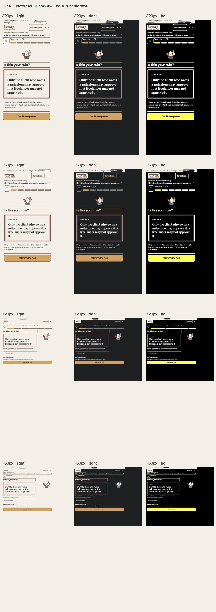

# Simplification: pinned shell

Baseline: `9a4a3f9`, the parity inventory committed before these changes.

## Changes

- Pinned wordmark, code-evidence control, current rule and compact progress.
- Requirement/snapshot sheet and flat More options menu reuse existing host messages.
- Locked progress opens the real prerequisite explanation and dispatches no stage/check action.
- Task scroll/focus resets on a step change.

## Evidence

The screenshot toolbar is explicitly outside the 640px app area. All twelve Confirm views at 320/360/720/760px have no horizontal overflow. The top including inset is 136px, action bar 66px and task scroll area 430px. The primary is visible. Locked Check click produced only the existing ready record and the prerequisite sheet.

Original Observe screenshots are in [before](../before/screenshots.json). The Observe ledger/footer and Evidence page are intentionally the next slice. The full default test run had three 5-second timeouts; a serial run with a 15-second development test timeout passed 139/139 and is recorded separately. This does not change a production runner timeout.

Browser preview records messages only. No fresh API, Graphify, native editor or learning-outcome claim is made.
