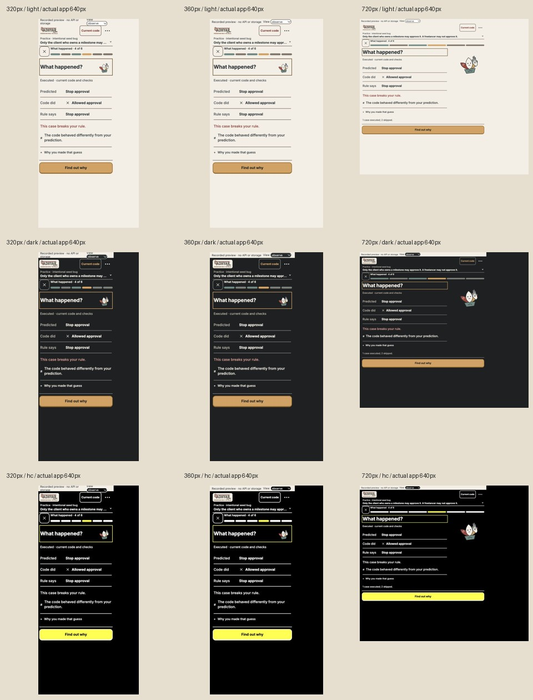

# Flat tasks and saved record

The actual renderer displays a single recorded comparison and retains one pinned primary action. Evidence opens over the current task. Technical provenance remains available; reflection uses the original save/acknowledgement contract. The direct hint control still opens the reviewed-sharing flow.

## Checks

- Three new regressions failed before the corresponding UI changes.
- Typecheck, lint and build passed. Focused presentation: 33/33; [full suite](tests.txt): 142/142, 28 files, 32.77 s, start 07:30:20 IST.
- [Nine measured screenshots](screenshots.json): 320, 360, 720px × light, dark, high contrast. Actual app height 640px, separate developer toolbar 24px. Top 136px; action 66px; task 430px; no horizontal overflow.
- [Browser interaction](interaction.json): technical-tab navigation, ArrowLeft return, focus restoration and an unsaved note retained through tab switching and sheet reopening. Only `ready` was recorded; no host/API/storage operation was executed.

Full-size captures: [320 light](320-light.png), [320 dark](320-dark.png), [320 HC](320-hc.png), [360 light](360-light.png), [360 dark](360-dark.png), [360 HC](360-hc.png), [720 light](720-light.png), [720 dark](720-dark.png), [720 HC](720-hc.png). [Timeline](evidence-timeline-360-hc.png), [technical view](evidence-technical-360-hc.png).

## Limits

Recorded runner results are real historical developer checks; graph/model/error scenarios are labelled UI specimens. Browser interactions do not establish native-host, API, assistive-technology or beginner learning acceptance. Narrow 64px lesson art and explicit feedback opening are documented in design-v2.md. The earlier installer predates these changes and needs rebuilding after the remaining simplification gates.
