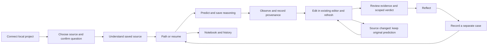

# Vadhyar — minimal learning companion

Status: **approved for implementation by the user and implemented**. Final human review remains pending. The original static artifacts are reference images; [implementation acceptance](implementation.md) records actual checks and limits. Prepared 14 October 2026, IST. Browser-first companion for an existing local project; the VS Code extension remains a separate supported surface.

## The recommendation

Make the next learning action the product's home. Use Duolingo's path, tactile controls, focused questions and specific feedback with Vadhyar's wordmark, manuscript warmth and source evidence. Two main surfaces: **Path** and **Lesson**. Three global destinations: **Path, Project, Notebook**. Everything the learner needs to judge a change remains reachable.

The learner's job: “After AI or I change my project, I want to understand one decision and check my reasoning so I can make the next change with confidence.” A beginner needs a manageable question; a working developer needs current source, impact and evidence without a compulsory tutorial.

This is a design hypothesis, not a validated teaching method. Static examples use the disclosed SeatCheck fixture. Its initial `canReserve` condition deliberately accepts zero seats (`seats >= 0`). This is illustrative content, never a required product project or a real learner record.

## Visual target

- [Visual board](visual-board.png): desktop path, desktop lesson, narrow prediction and narrow observation.
- [Desktop path](path-desktop.png), [desktop lesson](lesson-desktop.png), [390px prediction](lesson-mobile.png), [390px observation](observation-mobile.png).
- [Path after a relevant source change](path-source-changed.png): baseline prediction and earlier outcomes stay visible as historical records while the learner reviews the newer saved source.
- Editable SVG versions accompany each screen. These are static mockups; their controls do not execute actions. Exported typography may use platform fallbacks; the implementation must use the existing bundled fonts.
- Primary master: **desktop prediction lesson at 1440px**, with 1024px desktop and a practical 700–900px coding-panel adaptation. It establishes hierarchy, controls, source treatment, footer and feedback. The 390/320px checks concern minimum desktop-window and zoom robustness, not an equal product target. Legacy *-mobile filenames are retained as historical narrow-window references.

**Device boundary:** the current host binds to `127.0.0.1` and requires its fixed loopback Host/Origin and session. The supported target is a browser on that computer. The 390px artifacts describe a narrow desktop/split-window layout; they do not establish phone access. Actual phone use is unsupported. A separately scoped secure connection/pairing, per-device authorization and persistence/resume contract, followed by end-to-end physical-device acceptance, is required before claiming phone support.

**Where records live:** eligible-file metadata, the event ledger and selected source versions are durable host SQLite records. Learning attempts, notes and their history use this browser profile's local storage at the current address/port. Display **“Saved in this browser”** for learning records. They are not automatically shared between browsers, profiles, ports, computers or devices. A fresh browser can see host source history while lacking the earlier browser's learning record.

## What informed it

Four selected reference pages; [inspection evidence and limits](reference-evidence.md).

| Reference | Concrete adaptation |
| --- | --- |
| [Duolingo learning path, 2022](https://blog.duolingo.com/new-duolingo-home-screen-design/#quick-overview-what-are-the-big-changes) | A visible current step, short labeled activities, review within the journey. Use only available session activities. |
| [Duolingo core-tabs craft refresh, 4 February 2026](https://blog.duolingo.com/core-tabs-redesign/#4-flat-minimal-layout-with-heavy-white-space) | Flatter surfaces, whitespace instead of a container around everything, a small type system, purposeful artwork. |
| [Component Gallery: progress indicator](https://component.gallery/components/progress-indicator/) | Distinguish completed, current, upcoming and unavailable states with labels and shapes. |
| [Motion Primitives: transition panel](https://motion-primitives.com/docs/transition-panel) | Keep one task in place as content changes; deliberate Next/Previous behavior. Its code and dependency are not proposed for import. |

Duolingo's published learning claims do not establish Vadhyar efficacy. The path article is a historical reference, not verification of every current Duolingo app flow. No Duolingo artwork, proprietary font, copy or logo is included.

## Why the current UI feels generic

Observed in the existing local browser on 14 October; this is a design review of visible Today and Project views, not a whole-product audit.

| Priority | Observed issue | User consequence and principle | Proposed correction |
| --- | --- | --- | --- |
| High | A large introductory headline and illustration dominate Today. | Returning users must read an introduction before finding their next action; JTBD alignment. | Show the current question and resume action first. Use the About surface for product introduction. |
| High | Today, Learn, Practice, Project, Progress and Notebook compete as six peers. | A learner must understand the product taxonomy before acting; recognition over recall. | Three destinations, with practice and progress attached to a question and its record. |
| Medium | Source selection begins with alphabetically listed metadata, including documentation. | “Choose a useful file” requires knowledge a beginner may lack; progressive disclosure. | Preserve bounded search and paging; offer recorded recent source changes as a secondary entry and let the user confirm relevance. |
| Medium | The development ledger and broad coverage details occupy the main page. | Operational detail interrupts the learner's question; minimalist design. | A compact recording-status control opens the ledger and coverage details. Action-blocking errors remain visible. |
| Low | Large serif headlines, soft cards and an illustration communicate a brochure more than an interactive lesson. | The visual hierarchy gives little emphasis to decision and response. | Reserve serif for teacher/rule content; give the question, answer and action stronger geometry. |

Keep the original wordmark, local-source framing, readable source, bounded access disclosures and visible limitations. These already support confidence and control. Related content should sit together: rule with case, prediction with its revision, outcome with its provenance. The path must have a single visual continuation, and the active action must remain distinct from supporting evidence.

## Screen and navigation map

| Surface | Purpose | Primary action | Supporting access |
| --- | --- | --- | --- |
| Connection / first visit | Open the configured local project and explain what is recorded. | Connect or retry the existing local service. | Local setup instructions, coverage, optional prepared example. |
| Project / question setup | Pick bounded source, confirm a requirement and case, understand the selected decision. | Start this question. | Search, pages, excerpt, source walkthrough, optional approved explanation. |
| Path | Resume a saved question and see the next real activity. | Continue the current activity. | Review earlier records, choose a different question, recording status. |
| Lesson | Complete one meaningful task without losing its source context. | The current stage's save/refresh/review action. | Saved source, hint or explanation where supported, prior prediction, scoped evidence. |
| Notebook | Revisit notes, questions, assistance and outcomes. | Open the selected record. | Search, history, export, scoped progress details. |
| Settings / About | Configure supported teaching and manage local records. | The selected settings action. | Exact model state, sharing review, recoverable export/reset, product introduction. |

Project setup presents **Confirm → Understand** as intent acknowledgement and source exploration, not persisted or tested learning gates. A valid source/requirement/case starts the current attempt at `predict`; opening source or an optional explanation cannot earn an “Understood” or mastery badge. The current project lesson's persisted stages are **Predict → Observe → Change → Verify → Reflect → Separate case**. The mockups use those six lesson stages. Preserve the overall Confirm → Understand → Predict → Observe → Change → Verify journey; do not silently delete reflection or the separate case.

The path is an overview of the selected question's real activities, not an invented catalogue of courses. Labels, current step and step count come from the selected flow's registry and persisted state. Prepared extension flows and real-project browser flows need their own truthful registries; do not force their counts to match.

Guided and Review are self-selected presentation modes, not measured ability levels. Guided uses one task at a time and supportive prompts. Review exposes compact source/diff/evidence information and permits reading records directly; it cannot bypass prediction-before-observation, sharing approval, execution consent or freshness checks when recording a learning attempt.

### Destination migration

| Current destination | Proposed location | Preservation requirement |
| --- | --- | --- |
| Today | Path | Retain connection, resume and the recorder status/ledger through contextual access. |
| Learn | Current question's Lesson or question setup | Retain the source walkthrough and teaching actions. |
| Practice | Separate-case action on the selected question | Keep existing attempts and assistance declarations. |
| Project | Project | Retain search, bounded pages, source views, history and relationships. |
| Progress | Notebook → question record | Preserve actual counts, revisions and scope; remove decorative XP from the connected default. |
| Notebook | Notebook | Keep search, notes and export. |
| Website / prepared example / settings | About / project menu / settings | Preserve optional access and clear example labeling. |

Accept existing stored destination values and redirect their display; no storage reset or lost history. Capture a feature-parity checklist against the then-current checkout before changing navigation.

## Visual system

Inherit the brand and evidence rules in [root DESIGN.md](../../../DESIGN.md), [design-v2.md](../../../design-v2.md) and the current [prototype design](../../../prototype/DESIGN.md). This is the approved browser experience layer, now implemented in the connected companion. The connected prototype now uses the established v2 ochre primary; the existing palette is not replaced with Duolingo green.

| Role | Approved value / behavior |
| --- | --- |
| Canvas / ink | Parchment `#F4EFE6`; ink `#2C3539`. Warm, flat, restrained. |
| Main action | Ochre `#D9A05B`, charcoal `#1E2022` text, dark outline and a 4px bottom border. One dominant action. |
| Recorded / completed | Teal fill `#6A8A82`; small success text `#3F5F57`. A check means the named recorded activity completed, not mastery. |
| Discrepancy / execution failure | Terracotta `#A7413A`, icon and specific text. Never frame a learner as a failure. |
| Muted / outline | Muted text `#4E5659`, UI outline `#8B8273`; use existing theme and high-contrast mappings. |
| Interface type | Existing Inter 400/500/600; 28–32px task heading, 16px body, 14px supporting text. No oversized in-app marketing heading. |
| Teacher content | Existing Playfair Display 600, 22–26px for a confirmed rule or reflection quotation. |
| Source | Existing JetBrains Mono / source-view pattern, at least 13px target. Source typography, line anchors and syntax remain separate from brand illustration. |
| Spacing | 8px rhythm; 16px between related items, 24px between sections, 32px major separation. 24px narrow gutters; 16px at 320px. |
| Shapes | 12px answer/control corners, 16px sheets, 64–72px path nodes. 2px outline on interactive answer states, 4px primary bottom lip. |
| Artwork | Original wordmark, aspect ratio preserved. A small original lotus motif is implemented for path/feedback; no large books illustration on the home or over source. |

[Measured color pairs](contrast.json) accompany the handoff. Calculate theme/tint/focus pairs again against implemented colors; mockup colors are not a whole-interface accessibility audit. Use borders, text and icons so state never depends on color alone.

## Interaction contract

- A path node has a visible title. The current node has one adjacent Continue action. Earlier recorded nodes open their version-bound record; later activities explain what must be recorded first. No fake locked content. A stage being reached is not proof its evidence is fresh.
- Recorder state and lesson state are separate. The current native watcher can automatically record eligible saved changes and selected-file versions. The active lesson remains on its captured source until an explicit refresh/review action; automatic recording must not silently rewrite its prediction, case, observation or result. Render “Recording eligible files” only from a fresh `ProjectInfo.watching === true`; otherwise show unavailable/unknown recording and the supported recovery action. Watch coverage is bounded and is not every keystroke or complete project history.
- Label lesson source **“Captured source”** with its path, line range, capture time and expandable identity. A newer project revision alone signals activity, not that the selected rule changed. A relevant change signal shows “Newer saved source recorded”; otherwise use “Project activity since capture — selected-source freshness not checked”. Do not treat an unreceived change signal as proof of freshness.
- Keep the original prediction attached to baseline source. Following a relevant source change, observations and accepted verification from affected prior versions are historical. Historical nodes use a clock/neutral outline and an explicit prior-version label; they cannot remain a green current-result or completed-question badge. Retain every accepted verification before refresh invalidates current verification, including while awaiting reflection. Current-result styling requires the host's accepted freshness verdict for its declared source/manifest/project scope; imported-file or other dependency coverage must remain explicit rather than inferred from the selected file hash.
- Prediction has the case, prediction and reasoning together. If a supported case declares a finite outcome set, use large radio-style answer cards plus reasoning. For arbitrary project questions, retain a free-text prediction and reasoning. Never guess executable alternatives from prose.
- A selected answer is a draft until the existing save action succeeds. No auto-submit, automatic observation or inferred correctness. Keyboard arrows select actual radios; number shortcuts are optional only outside text inputs.
- Observation defaults to the current contract's self-report. A prepared executed case or a future supported runner must have separate provenance and an explicit run action. Saving a prediction must never execute arbitrary project code.
- Before recording observation, establish the available saved-source identity. If baseline A changed to B, block labeling B's outcome as A and offer a fresh attempt while retaining A's prediction. The learner still declares the runtime/method; a saved-source identity does not prove deployed/runtime identity.
- Feedback names the recorded fact: “Your report: booking allowed”, “Command exited 0”, or the named executed case outcome. Interpretation and the learner's scoped verdict remain separate.
- Source is a read-only contextual view with stable validated anchors. “Next source step” navigates a walkthrough only; “Continue lesson” advances a learning activity only. Map navigation cannot advance a prediction or verification gate.
- Change keeps editing in the learner's existing tool. Refresh reads saved source, preserves original prediction context and reveals the changed revision. The browser coach gains no edit or shell authority.
- An edit is optional: when the observed case already matches the intended rule, explicitly refresh unchanged saved source and continue with scoped evidence. Do not require a manufactured bug or change. Empty/whitespace/out-of-range source cannot start a source-based lesson.
- Verify uses the existing command-review dialog, exact command and source/manifest identities. “Run this exact check” is an execution consent action, distinct from recording a verdict. Generic exit success does not imply requirement coverage.
- Reflection and the separate case retain their existing assistance fields. An explicit “No additional help” choice can replace repetitive prose only if it maps faithfully to the contract; it is self-declared.
- Closing saves only through the current persistence contract. If drafts are unsaved or saving failed, show Keep working / Export / Discard through the existing protection. Never advertise autosave unless it is actually confirmed.
- Proof labels are factual: “Prediction saved”, “No Vadhyar hints recorded”, “Current check recorded”. No hearts, invented XP, league, mastery percentage, independent-authorship inference or unimplemented streak system.

## Required states

| Surface / state | Visible treatment | Recovery / allowed action |
| --- | --- | --- |
| No local service | Project connection panel, not an empty learning dashboard. | Existing launch/setup instructions; reconnect. |
| Indexing or partial scan | Real status and available bounded results; no invented progress percentage. | Browse available metadata; retry where supported; open coverage details. |
| No question yet | One focused “Choose a question” entry. | Select source, confirm rule and case. Optional example is secondary. |
| Search empty | Query and “No matching eligible files”. | Clear/change search, move to an available page. |
| Source unsupported / unreadable | Explain exact scope (text view vs unsupported concept parsing). | Choose another excerpt or use supported manual exploration. |
| Lesson draft / saving | Keep text and selection; show actual saving state. | Save once; prevent duplicate submissions. |
| Teaching not configured / pending / failed | Quiet setup path or named operation pending/error. | Continue local source exploration; configure supported provider; explicit retry without losing drafts. |
| Sharing approval | Requirement, real filenames, model and expandable exact context. | Cancel or send this reviewed context; additional scope needs new approval. |
| Source changed / stale result | Persistent amber status attached to the affected evidence. | Refresh/review; keep historical prediction and results; block stale execution/verification. |
| Relevant saved source changes after an accepted verification | Baseline prediction remains identified; observation/check nodes become historical, with no green current-result or completed-question badge. | Preserve the accepted result before any invalidation, including from the Reflect stage; explicitly refresh/review and obtain new scoped evidence. |
| Project activity without confirmed selected-source drift | “Activity since capture; selected-source freshness not checked”. | Review relevant files or refresh; do not infer whole-project freshness from a selected-file hash. |
| Watcher unavailable or status unknown | Named automatic-recording failure or unknown status; no green recording claim. | Retain host history and browser drafts; use supported read/reconnect/restart actions. Lesson refresh remains an explicit action. |
| Different browser/profile/address/port | Host source history may be available, while the learning record is empty here. | Explain “Saved in this browser”; import/export only through supported validated operations. No automatic cross-device resume. |
| Self-reported observation | Text badge beside the observation. | Record method/outcome; do not render it as an executed pass. |
| Check running / failure / error / timeout | Real operation status and bounded output; no fake timed success sequence. | Wait, inspect failure, explicitly retry only when allowed; retain prior evidence. |
| Command passed | Command result plus scope and separate requirement verdict. | Record reasoning and assistance; continue to reflection. |
| Save failed / corrupt record / another-tab change | Visible recovery alert; valid draft remains accessible. | Retry, export or reload after explicit discard review. |
| Completed activity / return | Factual summary and current next action. | Resume, open history, record a distinct case. No mastery claim. |

Decisions have both paths: cancel sharing stays local; absent checks uses manual evidence; unsupported parser keeps readable source when available; source drift keeps history but invalidates affected current results; exit with a draft keeps working or explicitly discards; changing presentation mode preserves state.

## Responsive and accessible behavior

- Desktop, starting at 1100px: 200–216px navigation, task column 600–680px, optional 320–400px source context. Main content is at most 1200px wide. No forced third analytics column.
- Tablet, 768–1099px: two columns only when text fits; source is an expandable region. Avoid squeezing the task or rendering an unreadable miniature graph.
- Narrow, 320–767px: same-computer browser/split-window layout with three labeled global destinations on non-lesson views. Lesson removes global navigation, uses one task column, a source sheet/disclosure and a full-width 56px primary. Answer targets are at least 48px. Touch-capable desktop use can be tested on supported hardware; width alone does not prove phone use.
- Text reflows at 200% zoom; large type gets scroll space. Source scrolls inside its region. The action footer respects safe areas and cannot cover the last input, status or virtual-keyboard focus.
- Visible focus, skip link, labeled native controls, dialog focus containment/return and Escape. Optional sheets have explicit close controls; touch does not depend on hover or dragging.
- Announce saving, scoped outcomes and errors without moving focus away from the answer. New stage focus goes to the task heading. Do not announce decorative path art.
- No timer, life penalty or required sound. Desktop narrow-layout, pointer/keyboard and supported touch-hardware acceptance belong to the first UI slice. Physical-phone acceptance is conditional on a separately implemented and approved connection mode; the loopback host is not reachable from a phone.

## Motion specification

These are the approved target values, aligned with existing tokens; reference timings and performance were not measured.

| Trigger | Motion | Purpose / reduced motion |
| --- | --- | --- |
| Pointer press on primary | 80ms, 2px press / bottom lip contraction. | Confirm input; remove movement for reduced motion and keyboard use. |
| Answer selection | 120ms tint/outline; visible checkmark. | Make draft selection obvious; static check and border remain. |
| Explicit stage advance | 180ms opacity, `cubic-bezier(.23,1,.32,1)`. | Preserve task location; keyboard/reduced-motion advance is immediate. |
| Supporting disclosure | 160–180ms opacity. | Show additional context; no animated source text or layout shift. |
| Confirmed result arrives | 160ms opacity after the result exists. | Feedback on actual evidence; never simulate sequential check completion. |
| Lesson record complete | One optional small lotus-petal reveal, up to 240ms. | Closure; static mark with reduced motion. Approval of the motif precedes adding an asset. |
| Source, map selection, repeated navigation | Immediate. | Keep inspection fast; no loading sweep, bounce or automatic tour playback. |

Use existing CSS transitions or platform animation features. Motion Primitives is a behavior reference; no Motion/Framer dependency is needed for this slice. Keep source, requirements and input positions stable. No ambient loops or sound feature in the first build.

## Parallel work and build sequence

This chat owns the approved UI implementation, design documentation and static reference board. **Complete browser code reuse** owns source concepts, walkthrough controls/map, provenance and its acceptance. **Plan Vadhyar rebuild workflow** owns feature/host workflow, saved versions, project scope, teaching setup and recovery. Their activity is separate from approval of this design.

1. **Master screen approved.** The user requested implementation. Desktop is primary; small-window references establish robustness only. The implementation preserves generic free-text prediction and contextual source access.
2. **Freeze the then-current contracts and feature inventory.** Reuse accepted `ProjectInfo`, `SourceSnapshot`, `ProjectAttempt`, run, teaching and walkthrough contracts. Capture legacy destination/history behavior. Resolve the active mixed checkout before a UI milestone; preserve other writers.
3. **UI-1: one existing real-project lesson.** Restyle the house controls, task hierarchy, source context and action footer. Start with Predict, then existing Observe/Change/Verify/Reflect/Separate-case states. No state-machine rewrite, new runner, new editor, new provider or automatic execution.
4. **UI-2: shell and Path.** Merge the destination presentation with compatibility for saved values; retain Project and Notebook features. Render the actual session stage registry. The first-visit path uses real project setup; no fabricated course or mock-data product dependency.
5. **UI-3: verification and factual reward polish.** Add approved static motif and scoped feedback; validate all recovery states before optional motion. Connect only capabilities verified by the feature/reuse lanes.

Implemented UI reach: `prototype/src/Workspace.tsx` (connected shell/records); `LearningPath.tsx` and `learning-path.ts` (path/registry); unchanged `App.tsx` and `pages.tsx` preserve the optional example’s destinations/data; `ProjectExplorer.tsx` (question entry); `ProjectLesson.tsx` (existing stages); `ui.tsx` (house controls/icons); `style.css` / `project-style.css` (tokens/layout). Preserve `ProjectSource` callers, `SourceViewer`, `SourceWalkthrough`, `StepControls`, `TeachingPanel` and `CompanionStatus` access. Inspect exact callers before edits, since these files are being changed by the parallel lanes. The current [feature contract](../../../prototype/feature-contract.md) supplies browser capabilities; extension-only prepared runners and inherited v2 “run case”/three-result examples cannot become generic browser behavior.

Keep existing project-learning/model/activity/service/source-concepts tests and persisted fixtures. Add behavioral tests only for changed navigation migration, record preservation or a new meaningful interaction. Config, build and dependency changes are unnecessary unless the then-current implementation demonstrates a concrete need.

### Acceptance before a UI checkpoint

- Actual prototype typecheck, lint, focused changed-behavior tests, browser build and full relevant suites; inspect owned diff and document actual commands/results.
- Prioritize 1440/1024px desktop and 700–900px coding panels; use 390/320px for window/zoom robustness; include long project names, paths and questions. Verify 200% zoom and source containment.
- Keyboard-only complete journey, dialog cancellation/focus return, supported touch controls, reduced motion and no horizontal document overflow in the same-computer browser. Phone keyboard/touch/connectivity/resume tests belong to the future approved connection slice.
- Confirm prediction-before-observation, stale source/result protection, exact sharing/execution consent, absence of source edits, resume/history/export and failed-save recovery.
- Record automatic watcher state separately from the captured lesson version. Exercise relevant source drift before observation and after accepted verification at both Reflect and Complete; preserve original prediction and all prior accepted outcomes, show historical badges, and require fresh scoped evidence before a current-result badge. Exercise an imported/dependency-file change during a check under the then-current host freshness contract; do not infer coverage from a selected-file hash alone.
- Check same-browser resume versus a fresh profile or changed address/port; use “Saved in this browser” and expose the real storage boundary without inventing shared progress.
- Scope all result wording to actual recorded/runner data. No model-generated correctness, requirement coverage or mastery inference.
- Short beginner/developer task walkthrough after implementation: ask each to find their next step, make a prediction, locate the condition and explain what the evidence establishes. Record confusion; do not infer learning gains from completion.
- Update existing design docs, README when behavior changes, actual IST changelog/AI-use/slice records, and a scoped checkpoint. No push without authorization.

## What stays outside this slice

Course marketplace, LMS, social feed, rankings, paid assets, new animation library, full-repository graph home, browser code editor, automatic repo execution, AI grading, universal language/scale guarantees, audio and habit economy. These do not help the first complete source → reasoning → evidence journey.

## Evidence and handoff status

Applied: Skill Router (fresh catalogue/routing), Design Critique (visible current-UI review), Figma User Flow Planner (entry/state/decision map), Emil Design Engineering (motion/interaction rules), Design Handoff Brief (constraints, success and edge cases). This is a local handoff; no Figma file or running redesigned app was created.

At the original planning checkpoint, Today/Project and four reference pages were inspected; the static exports, contrast arithmetic and local links were recorded in [validation.json](validation.json). That historical receipt predates the user’s implementation request. The current desktop implementation, browser journeys, fidelity comparisons and remaining limits are recorded in [implementation acceptance](implementation.md). Human approval authorized implementation; final human review of the delivered result remains pending.

## Logic review correction — 14 October 2026

Reviewed the [logic board's feedback](../../logic-board.md) against the current source. The native saved-file watcher is implemented and remains a capability; its initial suggestion that recording was explicit-only was superseded by its correction and direct source inspection. Loopback-only access, browser-scoped learning storage, captured active-lesson source and setup acknowledgement boundaries are now explicit. Static labels and an additional changed-source path state were corrected. Accepted-result archival and dependency-sensitive freshness remain acceptance gates for the implementation owner; the board maintains current correction status. This design lane changed no state machine, host, index or commit.
