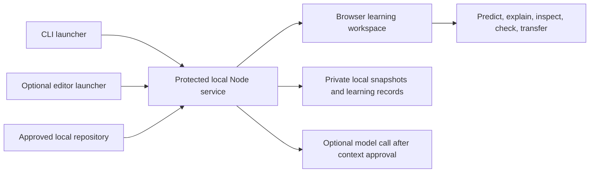

# Vadhyar browser rebuild — candidate direction

Prepared 13 October 2026, IST. Research proposal, not an approved implementation specification. No browser application, new dependency, migration, or release is implemented by this document. Read the [research report](README.md) and [source register](sources.md) together with this proposal.

## Product promise and audience

**Understand the rules in the app AI helped you build, and demonstrate that you can reason about the next change.**

The user requested an ongoing open-source application beyond a VS Code panel: a locally hosted browser experience, important functions and product logic, Duolingo-inspired learning, and updates after later development runs. The user explicitly selected **both beginners and working developers, with separate learning paths**. The event deadline is historical context, not this research phase's delivery constraint.

Vadhyar should map the supported project broadly and teach one meaningful decision at a time. A whole-repository map is an orientation aid; it cannot establish complete coverage or understanding of every path. Initially propose local JavaScript/TypeScript projects because that matches the existing implementation and dependencies. Other languages remain a later decision, not an implied capability.

### Two paths through the same evidence

| Path | Entry question | Experience | Evidence of progress |
| --- | --- | --- | --- |
| Guided learning | “What does this feature do, and why?” | Plain-language rule, small call path, worked example, prediction, hints, edit, transfer | Correct prediction with reasoning, actual observed result, assistance used, follow-up attempt |
| Developer review | “What changed, and what can it break?” | Diff-first view, callers, invariant, missing evidence, edge-case prediction, chosen check | Impact explanation, independently selected check, actual result and unresolved coverage |

Let users switch paths by topic. Do not require experienced developers to complete a beginner course to inspect their own project. Do not infer skill from job title or early quiz results.

## Three architectural options

| Option | Benefit | Cost / limitation | Recommendation |
| --- | --- | --- | --- |
| Local service + browser UI + optional editor launcher | Works without VS Code; local file authority stays outside browser; reuses React and Node logic | Must build a protected local API and replace native host interactions | **Preferred candidate** |
| Extension-owned service + browser UI | Faster initial bridge from the current controller and SecretStorage | VS Code remains mandatory; host lifecycle and remote-port behavior complicate independence | Useful transitional experiment only |
| Desktop wrapper | Bundles a runtime and supports OS integration | Adds packaging, updates and another platform boundary before learning value is tested | Defer |

The core application should start from a terminal or an optional editor command and open one browser tab. An extension is a launcher and source-navigation adapter, not the only runtime. Illustrative future command: `vadhyar open .`; it does not exist today. A browser extension is unnecessary for the first slice.

Do not load local repositories directly into a normal webpage and claim filesystem authority. The local service owns approved roots, path validation, snapshots, graph extraction, storage, optional coaching and consented check execution. The browser renders validated state and requests named actions. The model cannot choose arbitrary files, edit learner code or launch commands.

## Browser workspace

Keep five destinations in the first product direction; they may share one screen rather than become five subsystems.

| Destination | What the user needs |
| --- | --- |
| Project overview | Supported files, omissions, app entrypoints and a small feature map; pick a feature rather than face a graph wall |
| Understand a decision | Intended rule, relevant current source, callers/callees, state/data effects, edge cases and evidence labels |
| Practice | One prediction, reasoning, bounded observation, hints, an independent edit and a transfer task |
| What changed | Baseline/current diff, affected topics, invalidated evidence and new learning suggestions |
| Progress and settings | Historical attempts, current evidence, path selection, sharing controls, model status and scoped export/delete |

Every decision card should answer: What rule is implemented? What inputs matter? When does this function run? Which verified callers lead to it? What outputs or side effects follow? Why is this rule intended? What could a change break? What did we not inspect?

**“Why” needs two separate fields:** observable code behavior and confirmed product intent. A model may propose a rationale. Without a requirement, maintainer explanation or other evidence, label the intention unconfirmed. A source citation proves the cited text exists, not that the explanation is correct.

## Selecting the important logic

Begin with the user's selected feature and confirmed intent. Expand to current entrypoints, changed decision spans, direct callers, imports, boundary validation and nearby checks. Prefer rules affecting authorization, input acceptance, money calculations, persistence and state transitions. These are prioritization signals, not a correctness score.

Use dependency count or complexity only as supplementary signals. A small ownership check may matter more than a large utility module. Propose three topics with their selection reasons and let the developer confirm or replace one. Do not generate a lesson for every symbol.

Keep relationship provenance visible: extracted static relation, framework/heuristic interpretation, model proposal, or observed runtime behavior. Imported files do not prove a particular branch executes. Dynamic dispatch, callbacks, generated routes and framework wiring require explicit coverage limits. Runtime traces are deferred until there is a concrete need and safe adapter.

## A small learning loop

1. Confirm one product rule and inspect a short path through the source.
2. Show one worked example appropriate to the chosen path.
3. Ask the developer to predict an unseen input or explain an invariant **before** revealing the result.
4. Record the prediction and reasoning, then reveal source-supported behavior or a consented actual check.
5. Offer progressively stronger hints, preserving the assistance level. The coach does not supply a finished patch.
6. The developer edits in their own editor; inspect the saved diff and chosen checks.
7. Ask a related transfer question or small independent change; distinguish coached and unassisted attempts.

Target a 5–10 minute lesson as a design hypothesis to test, not a measured duration. When executable evidence is unavailable, use a read-only reasoning lesson and state that its answer is based on analysis rather than execution. Arbitrary tests cannot certify an inferred requirement.

Duolingo inspiration should mean short sessions, useful feedback and revisiting relevant ideas. Start with a visible topic path and completed attempts. Treat optional XP or a light streak as participation feedback. Avoid hearts/lives, public leaderboards and repository-completion percentages in the first version. Do not label an LLM-graded explanation “mastery.”

## Refresh after subsequent development

Interpret “after every run” as saved source changes and, where supported, an explicit coding-session-completed event. Vadhyar cannot universally observe private conversations or determine where an arbitrary agent run begins or ends.

| Event | Proposed behavior |
| --- | --- |
| Save, create, delete or rename | Debounce local change detection, capture the current approved source and compare identities |
| Large AI change | Coalesce events, cancel obsolete analysis and offer one stable snapshot for review |
| Relevant identity changes | Immediately mark affected explanations, citations and run results historical; block stale actions |
| Same contents on a repeated run | Keep the identity; do not add duplicate lesson history or request a new model response |
| Watcher failure / tab reconnect | Disclose degraded detection; rescan on reconnect and provide an explicit Refresh action |
| Requirement or check changes | Reconfirm intent or check selection before using prior approval |

A watcher event is a hint, not the source of truth. Recompute content identities before source navigation, sharing and checks. Node documents platform and filesystem caveats for `fs.watch`; a changed path alone is insufficient. [Node filesystem documentation](https://nodejs.org/api/fs.html#fswatchfilename-options-listener).

Refresh local metadata automatically; keep remote coaching and tests explicit. Model cost must not grow with every keystroke. Keep the last valid map as historical when refresh fails. Preserve older attempts; queue reassessment for a changed rule rather than erasing everything the person learned. Begin with conservative file-level invalidation, then narrow it only when dependable symbol dependencies justify it.

## Local hosting, privacy and execution

Local storage does not imply offline coaching. The UI must distinguish the local filesystem/map/history from any source excerpts sent to a remote model. No-model use should support navigation, changes and manual reasoning records; richer coaching can use the existing provider behind explicit sharing approval. Local-model support is a later experiment, not an assumed dependency or current capability.

Proposed local API requirements: loopback binding, fresh session authentication, strict Host/Origin checks, same-origin browser requests, bounded schemas and request sizes, and no wildcard CORS. Loopback alone does not establish a safe boundary. Keep session credentials out of URLs/logs; define and test the local launch handshake in the first implementation specification.

Keep model credentials in the service/editor secret facility, never browser state. Standalone launch must have an explicit credential method; it cannot silently depend on VS Code SecretStorage. Do not expose repository roots, arbitrary command strings or private session exports through unvalidated requests. Preserve path containment/symlink protections, private-content exclusions, safe text rendering and content-preview approval. Redacted diagnostics contain operation IDs, timings and error categories only.

An existing repository's test command still executes repository code. Keep the current trusted-workspace/explicit-command boundary in the browser design, revalidate after approval, strip model credentials from child environments and state that this is not a hostile-code sandbox. Tests do not execute automatically when a repository is opened or refreshed.

For desktop VS Code, its supported `env.openExternal` API can launch the browser. Remote workspace tunnelling has its own lifecycle; defer remote support until separately exercised. [VS Code API](https://code.visualstudio.com/api/references/vscode-api), [remote extensions](https://code.visualstudio.com/api/advanced-topics/remote-extensions).

## Reuse and migration scope

Current source was inspected on `codex/panel-v2-phase0`, HEAD `102a1ecce30f8bd512f4ba46bbcbac181438ae9a`, with mixed uncommitted safety/UI/documentation work. Prior acceptance records are historical and were not rerun for this research.

| Current asset | Candidate action | Callers / verification affected |
| --- | --- | --- |
| `src/project/model.ts`, `shared.ts` | Reuse bounded snapshots, changes, intents and storage schemas; retain content privacy | Controller, preview/coach, tests and record compatibility |
| `src/project/topics.ts` | Retain validated extraction/provenance; investigate JS/TS coverage before promising function-level flow | Controller, guide context, graph fixtures and adapter tests |
| `src/extension/privacy.ts`, `source.ts` | Reuse private-content checks and source hashes in the local service | Model, coach, checks, source-boundary and privacy tests |
| `src/project/checks.ts` | Reuse selected existing-check execution with consent/freshness moved to service boundary | Controller, process tests and browser consent |
| `src/project/controller.ts` | Extract its domain actions from VS Code-specific trust, storage, pickers, watchers and navigation | `src/extension/extension.ts`, controller/resume/reuse tests |
| `src/panel/project.tsx`, house controls | Reuse React components and accessible patterns; replace host transport and VS Code-only styling gradually | Shared messages, panel tests, real browser checks |
| NovaDesk and SeatCheck | Keep disclosed seeded fixtures and prior evidence as regression material | Prepared runner/tests, release artifacts and documentation |

The model/source modules already use Node/platform primitives; that reduces migration work. The controller's `vscode` API dependency is the main application boundary. The existing Project Guide already watches saved changes with a debounce; browser refresh is a transport/lifecycle change, not a reason to invent a second snapshot system.

Graphify currently has a Python/runtime setup burden and macOS-specific network-denial behavior. Treat retaining it versus using the already-installed TypeScript compiler for a JS/TS-first extractor as a measured integration decision. Neither option has been benchmarked here. Do not add a second graph engine until a supported repository exposes a missing relationship.

The [upstream assessment](reuse-candidates.md) recommends the published React Flow package for the browser map, restricted CodeTour-style checkpoints, and selective teaching patterns from Learn Claude Code/PocketFlow. These do not replace Vadhyar's source-bound evidence. Inspected Graphify upstream is 0.9.89 while the current adapter requires 0.9.84; compare schemas before upgrading. Do not import RAG_Techniques' restricted code or add Memvid/Langfuse infrastructure to the first browser slice.

Keep VS Code workspace records intact. Propose explicit versioned import/export after the browser store exists; no automatic migration, deletion or broad reset. Keep `outputs/live-demo/`, ignore rules and Graft artifacts as evidence, not application source to transplant wholesale.

## Research-led build sequence

These are candidate milestones with exit evidence, not an executable plan or delivery estimate. Each milestone needs a bounded implementation specification before coding.

| Order | Milestone | Done criterion |
| --- | --- | --- |
| R0 | Validate the pain and lesson concept | Observe five people per audience on an actual recent AI change; walk through a manually prepared lesson concept; retain disagreements and workflow overhead |
| B0 | Establish a maintainable baseline | Reconcile owned uncommitted work; run current checks; record a clean checkpoint without rewriting shared history; decide license and supported platforms |
| B1 | One local browser vertical slice | Open one trusted JS/TS repo, inspect current source/diff, save one prediction and resume it after restart; no VS Code dependency required |
| B2 | One source-grounded lesson | Confirm a rule, validated call path/citations, prediction, optional approved explanation, actual selected check and transfer record |
| B3 | Change-aware continuity | A second change invalidates the affected evidence, preserves history, updates the browser and rejects stale concurrent results |
| B4 | Separate paths and broader proof | Beginner and developer flows work on at least three independent small repos; missing relationships/coverage remain visible |
| B5 | Public OSS release | License/notices, contribution and security guidance, CI, reproducible clean install, supported-OS browser acceptance, release notes and versioned storage behavior |

R0 is a small discovery study, not statistical efficacy proof. A later controlled learning pilot is needed before public improvement claims. B1 should use the existing React, Node, TypeScript, Zod and test stack. Native HTTP plus a one-way update stream is a candidate; add a web framework only if the slice's actual needs justify it. No cloud accounts, collaboration server, vector database, autonomous agent loop or LMS in the first slice.

## Open-source maintenance

The inspected root manifest is `private: true`, `license: UNLICENSED`; no tracked top-level license, contribution guide or security policy was found. This is a release-readiness gap, not a license change performed here. A public repository needs an appropriate license to grant reuse rights. [GitHub Open Source Guides](https://opensource.guide/legal/).

Choose an OSI-approved license with the project owner and reconcile contributor/third-party notices before release. MIT is a candidate for a permissive project; no license is selected by this research. Keep event records intact and move ongoing positioning/setup into clearly dated current documentation when behavior actually changes.

Use one issue-backed milestone at a time, a maintained support matrix, meaningful regression tests, locked dependencies, CI and exact artifact acceptance. Cover stale source, corrupt storage, path escapes, prompt injection, malformed model output, missing graph dependencies and cancelled/abnormal test runs. Preserve keyboard navigation, text alternatives to graphs, reduced motion and accessible feedback. Publish compatibility/migration notes with changes to stored evidence.

## Decisions still needing validation

- Does a learner complete a useful independent change, rather than merely read a convincing explanation?
- Is a 5–10 minute lesson acceptable after normal development, and does the developer path earn its overhead?
- Which three representative JS/TS apps should define initial call-flow coverage?
- Can function-level evidence be reliable enough without adding more extraction infrastructure?
- Which operating systems can be tested and maintained for the first public release?
- Which license and contributor terms match the owner's intended reuse?

The immediate next action is to review the research and candidate browser-first direction, then specify B1. Application coding, publishing and pushing are outside this research phase.
